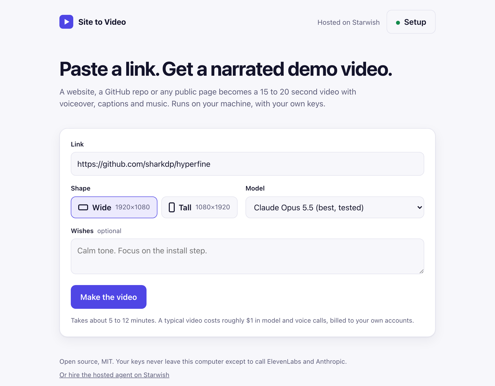
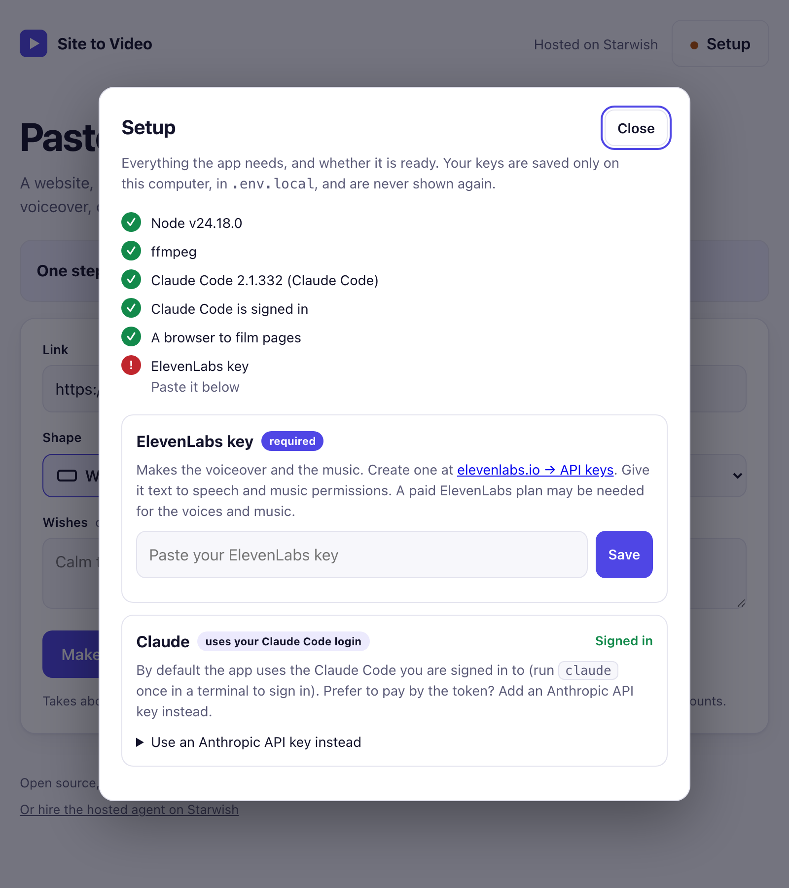

# Site to Video

**Paste a link. Get a 15 to 20 second narrated demo video.**

A website, a GitHub repo or any public page goes in. Out comes an MP4 with voiceover, captions and music, a thumbnail, and notes on what was filmed. It runs as a small app on your own computer, with your own ElevenLabs and Claude accounts.



Prefer not to set anything up? The same agent is hosted on Starwish, where you just send a link: **https://starwish.ing/@yukitanaka/site-to-video**

## Quick start

You need [Node.js 22.12+](https://nodejs.org), [ffmpeg](https://ffmpeg.org), [Claude Code](https://claude.com/claude-code) and an [ElevenLabs](https://elevenlabs.io) account.

```sh
git clone https://github.com/yukitanakachez/site-to-video.git
cd site-to-video
npm run setup     # installs everything and checks your machine
npm start         # opens the app at http://localhost:4173
```

`npm run setup` installs the packages and downloads the browser used for filming and rendering, then tells you exactly what is missing and how to fix it. The app opens in your browser. The first time, a **Setup** panel asks for your keys:



1. **ElevenLabs key** (required). Create one at [elevenlabs.io/app/settings/api-keys](https://elevenlabs.io/app/settings/api-keys), give it text to speech and music permissions, and paste it into the box. The app checks it and saves it. ElevenLabs may require a paid plan for the voices and music.
2. **Claude.** By default the app uses the Claude Code you are signed in to: run `claude` once in a terminal and sign in. If you would rather pay by the token, open "Use an Anthropic API key instead" and paste an `sk-ant-…` key.

Then paste a link, choose **Wide** (1920×1080) or **Tall** (1080×1920), optionally add wishes ("calm tone, focus on the install step"), and press **Make the video**. You watch the eight steps go by, and the video appears on the page when it is done, with download buttons. Earlier videos stay on the page.

Installing ffmpeg: `brew install ffmpeg` on a Mac, `sudo apt install ffmpeg` on Linux. On a Mac with Homebrew, the whole thing is: `brew install node ffmpeg`, then the three commands above.

### Where your keys go

Keys are saved in `.env.local` in this folder, readable only by you (mode 600) and ignored by git. The app never shows a key again after you save it, only its last four characters. You can also skip the app and `export ELEVENLABS_API_KEY=...` in your shell, which takes priority. Keys are used only to call ElevenLabs and Anthropic. The app listens on `127.0.0.1` only and refuses requests from other sites.

### What it costs

You pay your own accounts, so nothing is marked up. As measured on the hosted agent with Claude Opus 5.5: about **$0.92** for a typical video and about **$2.63** for a heavy one, covering the model and the ElevenLabs voice and music. A run takes about 5 to 12 minutes. If you use your Claude Code login, the model part counts against your Claude plan instead. The model menu has a cheaper Claude Sonnet 5.5 option, but the agent was built and tested on Opus.

### Run it from the terminal

The app drives the same script you can run yourself:

```sh
node local/run-job.mjs --url https://github.com/sharkdp/hyperfine --format tall
node local/run-job.mjs --url https://www.raycast.com --format wide --request "calm tone" --dry-run
```

`--dry-run` prints what it would do and runs nothing. Each run gets a folder under `runs/` (the app) or `local-runs/` (the script): the video, thumbnail and notes are in `job/output/`, the working files in `job/work/`.

### If something goes wrong

| What you see | Fix |
|---|---|
| Setup shows a red or orange item | The panel says what to install. `npm run setup` re-checks everything |
| "ElevenLabs does not recognise this key" | Copy the key again from ElevenLabs, with no spaces. Keys start with `sk_` |
| "The key works, but it is limited" | Edit the key in ElevenLabs and allow text to speech and music generation |
| "Port 4173 is busy" | `PORT=4180 npm start` |
| No video, and the notes say it refused | The agent refuses links that are private, error pages, bot checks, harmful content or pages with too little to say. Try another link |
| Claude Code asks you to sign in | Run `claude` in a terminal and sign in, then try again |
| Anything else | Open "Show the log" under the progress steps, or read `runs/<run>/run.jsonl` |

### Please read: it runs commands on your computer

The agent is Claude Code working on your machine. It films the page in a browser, runs ffmpeg and renders with Remotion, and it reads text from sites you point it at. It is told never to follow instructions found on a page, never to type into or submit forms on a live site, and never to run a repo it reads, and its programs check what goes into the video. Still, treat links like any untrusted input: if you point it at sites you do not trust, run it in a container or a throwaway user account. Auto memory is switched off for its runs.

## What goes in and what comes out

You give it:

- the public link, `http` or `https`;
- the shape: `wide` (1920×1080) or `tall` (1080×1920);
- optionally, a few wishes in the request text (focus, tone). The wishes cannot override the honesty and safety rules.

You get three files:

- `demo.mp4`: the video, H.264 and AAC at 30 fps, 15–20 seconds, with narration, captions and music;
- `poster.png`: a thumbnail frame;
- `result.md`: the moments with their times, the narration script, the voice and the music brief.

The agent refuses with only `result.md` in these cases:

- the link is not public, or it is refused after redirects;
- the page is an error page or a bot check;
- the page is mostly not in Latin script;
- the visit finds fewer than 4 facts;
- the content is harmful;
- the video cannot be made to pass its checks.

Starwish refunds a refused job.

## How a job runs

`prompt.md` takes the model through eight stages. It is generated: edit `prompt.src.md`, then run `node kit/build-prompt.mjs`. That script fills in the paths and the numbers that follow the pace in `config/config.json`. A test fails when `prompt.md` is stale. Each stage starts with `node kit/stage.mjs <stage>`. It refuses to open a stage until the earlier stages were opened in order and their files exist.

1. **Visit.** Scout the link (`kit/scout.mjs`) or clone the repo (`kit/github.mjs`). Write `facts.json`, the only words the video may show or say, and `visit.md`.
2. **Scout.** Scout the page to film at the customer's format. If that is the page the visit already scouted, at the same format, `--reuse` copies the visit's files instead.
3. **Direct.** Write `shotlist.json`: the moments, the camera moves, the narration and the captions, each citing its facts. `kit/validate-shotlist.mjs` checks it.
4. **Capture.** Record any clip moments in a real browser (`kit/capture.mjs`, virtual time, so a slow machine is never choppy). On a live product the agent only scrolls, hovers and clicks the site's own tabs, menus and example buttons. It never types, submits forms or signs up.
5. **Sound.** Call the `make-audio` tool twice: the voice, then the music.
6. **Render.** `kit/render.mjs` renders the video with Remotion at the pace in `config/config.json` (1.3×).
7. **Check.** `kit/check-video.mjs` runs the hard checks and writes review frames. The model looks at the frames and fixes what it sees, at most twice.
8. **Deliver.** `check-video.mjs --package` copies `demo.mp4` and `poster.png` to the output, but only for a passing video whose stages were all opened in order. The model then writes `result.md`.

## Developing

```sh
npm test                 # the unit tests, the app's server and the key file (no network, no keys)
npm run test:render      # capture and render, slower
node kit/build-prompt.mjs   # regenerate prompt.md after editing prompt.src.md (a test fails when it is stale)
```

`ui/` is the app: `server.mjs` (Node built-ins only) and `public/`. `lib/env-file.mjs` reads and writes the keys. `local/run-job.mjs` runs one whole job. The rest is the agent.

## The hosted version

`agent.yaml` is the Starwish listing (the harness, the `make-audio` tool, tests). On Starwish the ElevenLabs key is held by the platform and the price covers the calls. To publish your own copy you need the Starwish CLI: `starwish credentials set ELEVENLABS_API_KEY --agent . --web`, `starwish doctor . --json`, `starwish dev . "Make a demo video." --params '{"url":"https://svelte.dev","format":"wide"}'`, then `starwish publish .`. Change `name` first.

## Licenses

The code here is MIT (`LICENSE`). The video renders with [Remotion](https://remotion.dev), which has its own license terms for companies: read [remotion.dev/license](https://remotion.dev/license) if you use this commercially. Fonts are Inter and JetBrains Mono (SIL Open Font License). Voices and music come from ElevenLabs under your account's terms, which limit handing over narration or music as separate audio files; this app only ever delivers the finished video.

## Folder map

```
agent.yaml        the listing: inputs, outputs, harness, workspace install, the make-audio tool, tests
prompt.src.md     the eight stages, written by hand
prompt.md         generated from prompt.src.md (node kit/build-prompt.mjs)
config/           config.json (Chrome's path on the work machine, the pace), voices.json (the voices)
kit/              the programs the model runs: stage, scout, github, validate-shotlist, capture,
                  render, check-video, build-prompt
lib/              the rules they share: link safety, facts and honesty, shot-list limits, pace,
                  the stage process, paths
render/           the Remotion composition and its fonts (Inter, JetBrains Mono)
tools/make-audio  the ElevenLabs tool (voice, music); only it sees the key
ui/               the app: server.mjs and public/ (the page)
scripts/          setup.mjs, the one-command setup
local/            run-job.mjs, a whole job on this machine
test/             the tests (npm test; npm run test:render for capture and render)
costs.json        the cost worksheet behind the hosted price
DECISIONS.md      what was decided and measured, and why
```
